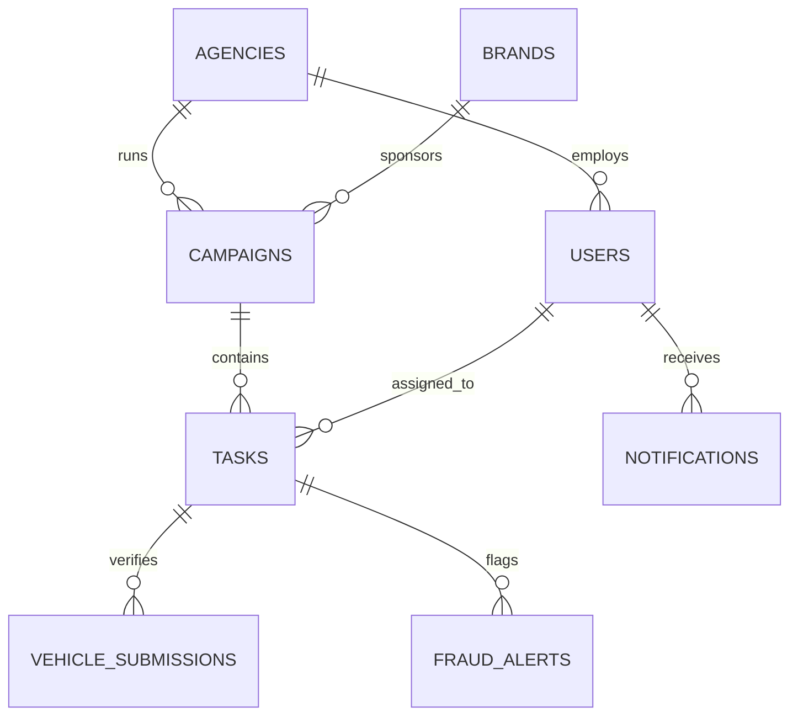

# MOVIQ Database Schema Documentation

This document describes the complete MongoDB database architecture, collections, document schemas, indexes, and relationships for the **MOVIQ** OOH / Transit Media Operations & Verification Platform.

---

## 1. Overview & Connection Architecture

MOVIQ uses **MongoDB** as its primary data store with asynchronous I/O via `motor` (Python AsyncIO driver for MongoDB).

- **Database Name**: Default `moviq` (configurable via `DB_NAME` environment variable).
- **Connection URI**: Configured via `MONGO_URL` in `backend/.env`.
- **Initialization Mechanism**: Automatic upon backend startup (`on_startup()` in `backend/server.py`). If collections are empty, initial data and platform users are provisioned automatically via `backend/seeder.py`.
- **Primary Keys**: Custom string IDs (e.g. `u1`, `a1`, `c1`, `TK-2026-XXXX`, `vs_xxxx`) alongside MongoDB's default internal `_id`. The API layer automatically removes internal `_id` and exposes clean JSON.

---

## 2. Entity Relationship Overview



---

## 3. Collections Directory

| Collection Name | Purpose | Primary Key Format |
|---|---|---|
| `users` | Platform accounts (Super Admin, Platform Admin, Agency Heads, Field Execs) | `u1`, `u2`, or `u_<uuid>` |
| `agencies` | Outdoor advertising agencies managing transit campaigns | `a1`, `a2`, or `a<hex>` |
| `brands` | Client advertisers (NoBroker, Zepto, Rapido, etc.) | `b1`, `b2`, etc. |
| `campaigns` | Transit / OOH advertising campaigns | `c1`, `c2`, or `c_<hex>` |
| `media_types` | Catalog of transit & outdoor media formats (Cab, Auto, Bus, etc.) | Slug `key` (e.g. `cab_branding`) |
| `tasks` | Unit branding tasks assigned to vehicles or locations | `t1` or Task Code `TK-2026-XXXX` |
| `vehicle_submissions` | Photo verification submissions from WhatsApp Bot & Web Chat | `vs_<hex>` |
| `fraud_alerts` | Automated & manual fraud detection alerts | `f1` or `f_<hex>` |
| `field_executives` | Profiles and historical performance metrics for field agents | `fe1`, `fe2`, etc. |
| `supervisors` | Team leads managing field executives across target cities | `s1`, `s2`, etc. |
| `notifications` | Real-time event feed for platform admins and agencies | `n1` or `n_<hex>` |
| `whatsapp_sessions` | Multi-step conversational state machine for WhatsApp bot | Phone string (e.g. `919876543210`) |
| `webhook_logs` | Raw payload audit logs for WhatsApp, WATI, and Twilio webhooks | Auto ObjectId |
| `city_stats` | Pre-aggregated city-level task completion statistics | City name string |
| `monthly_stats` | Pre-aggregated monthly financial and campaign statistics | Month string |

---

## 4. Collection Schemas & Field Definitions

### 4.1. `users`
Stores all platform users across roles with bcrypt-hashed passwords.

| Field | Type | Required | Description |
|---|---|---|---|
| `id` | `String` | Yes | Unique user identifier (`u1` or `u_<uuid>`) |
| `name` | `String` | Yes | Full name |
| `email` | `String` | Optional | Email address (unique for admins and agency heads) |
| `phone` | `String` | Optional | Phone number (used for field agents & WhatsApp auth) |
| `role` | `String` | Yes | User role: `'admin'`, `'agency'`, `'supervisor'`, `'field'` |
| `subRole` | `String` | No | Sub-classification (e.g. `'Super Admin'`, `'Platform Admin'`) |
| `avatar` | `String` | No | Initials or profile image URL |
| `agencyId` | `String` | Conditional | Foreign key to `agencies.id` (required if role is `'agency'`) |
| `agencyName` | `String` | No | Denormalized agency name for fast display |
| `city` | `String` | No | Assigned city (e.g. `'Bengaluru'`) |
| `supervisor` | `String` | No | Supervisor name for field agents |
| `tasksDone` | `Number` | No | Total completed tasks counter (for field agents) |
| `status` | `String` | Yes | Account status: `'active'`, `'pending'`, `'inactive'` |
| `password_hash`| `String` | Yes | Bcrypt hash of password |
| `createdAt` | `String (ISO)`| No | Account creation timestamp |

```json
{
  "id": "u1",
  "name": "Deepak Bansal",
  "email": "admin@moviq.in",
  "role": "admin",
  "subRole": "Super Admin",
  "avatar": "DB",
  "status": "active",
  "password_hash": "$2b$12$KIX...",
  "createdAt": "2025-01-01T00:00:00Z"
}
```

---

### 4.2. `agencies`
Stores advertising agencies that execute media branding campaigns.

| Field | Type | Required | Description |
|---|---|---|---|
| `id` | `String` | Yes | Unique agency identifier (`a1`, `a2`) |
| `name` | `String` | Yes | Agency company name |
| `head` | `String` | No | Agency founder or operational head |
| `email` | `String` | Yes | Official contact email |
| `phone` | `String` | No | Contact phone number |
| `city` | `String` | No | Primary headquarters city |
| `plan` | `String` | Yes | Subscription plan: `'Enterprise'`, `'Growth'`, `'Free'` |
| `campaignLimit`| `Number` | Yes | Maximum active campaigns allowed (default 10) |
| `campaigns` | `Number` | Yes | Number of active/lifetime campaigns |
| `activeUsers` | `Number` | Yes | Total team members linked to this agency |
| `revenue` | `Number` | Yes | Platform revenue generated (INR) |
| `status` | `String` | Yes | Agency status: `'active'`, `'trial'`, `'inactive'` |
| `joinedAt` | `String (YYYY-MM-DD)` | Yes | Onboarding date |

```json
{
  "id": "a1",
  "name": "BrightAds Media",
  "head": "Saurav Mehta",
  "email": "saurav@brightads.in",
  "phone": "+91 98450 12345",
  "city": "Bengaluru",
  "campaigns": 24,
  "campaignLimit": 20,
  "activeUsers": 45,
  "status": "active",
  "plan": "Enterprise",
  "revenue": 1245000,
  "joinedAt": "2024-08-12"
}
```

---

### 4.3. `brands`
Stores advertiser clients sponsoring transit advertising campaigns.

| Field | Type | Required | Description |
|---|---|---|---|
| `id` | `String` | Yes | Brand identifier (`b1`, `b2`) |
| `name` | `String` | Yes | Brand name (e.g. `'NoBroker'`, `'Zepto'`) |
| `category` | `String` | Yes | Industry vertical (`'Real Estate'`, `'Q-Commerce'`) |
| `logo` | `String` | No | Brand emoji or logo URL |
| `campaigns` | `Number` | Yes | Count of campaigns run |
| `spend` | `Number` | Yes | Total media spend in INR |

```json
{
  "id": "b1",
  "name": "NoBroker",
  "category": "Real Estate",
  "logo": "🏡",
  "campaigns": 6,
  "spend": 850000
}
```

---

### 4.4. `campaigns`
Stores client marketing campaigns, media format targets, budgets, and operational progress.

| Field | Type | Required | Description |
|---|---|---|---|
| `id` | `String` | Yes | Campaign identifier (`c1`, `c2`) |
| `title` | `String` | Yes | Campaign title |
| `brand` | `String` | Yes | Associated brand name |
| `brandId` | `String` | No | Foreign key to `brands.id` |
| `agency` | `String` | Yes | Executing agency name |
| `agencyId` | `String` | Yes | Foreign key to `agencies.id` |
| `mediaType` | `String` | Yes | Target media type (e.g. `'Auto Branding'`, `'Cab Branding'`) |
| `city` | `String` | Yes | Target market / city |
| `totalTasks` | `Number` | Yes | Target number of vehicle/unit installations |
| `completed` | `Number` | Yes | Verified successfully completed tasks |
| `flagged` | `Number` | Yes | Tasks currently flagged for review |
| `status` | `String` | Yes | Status: `'ongoing'`, `'completed'`, `'paused'`, `'draft'` |
| `startDate` | `String (YYYY-MM-DD)` | Yes | Campaign start date |
| `endDate` | `String (YYYY-MM-DD)` | Yes | Campaign conclusion date |
| `budget` | `Number` | Yes | Total budget allocated in INR |
| `spent` | `Number` | Yes | Amount spent to date in INR |

```json
{
  "id": "c1",
  "title": "NoBroker Auto Blitz Q3",
  "brand": "NoBroker",
  "brandId": "b1",
  "agency": "BrightAds Media",
  "agencyId": "a1",
  "mediaType": "Auto Branding",
  "city": "Bengaluru",
  "totalTasks": 1500,
  "completed": 653,
  "flagged": 8,
  "status": "ongoing",
  "startDate": "2025-06-15",
  "endDate": "2025-08-30",
  "budget": 750000,
  "spent": 320000
}
```

---

### 4.5. `tasks`
Stores individual installation and audit tasks assigned to vehicles or locations.

| Field | Type | Required | Description |
|---|---|---|---|
| `id` | `String` | Yes | Unique ID or Task Code (`TK-2026-XXXX`) |
| `taskCode` | `String` | Yes | Unique traceable code (indexed for audit & reports) |
| `campaignId` | `String` | Yes | Foreign key to `campaigns.id` |
| `agencyId` | `String` | No | Foreign key to `agencies.id` |
| `unitCode` | `String` | No | Fleet inventory / unit identifier (e.g. `'A-012'`) |
| `vehicle` | `String` | No | Indian vehicle registration number (e.g. `'KA-01-AB-1234'`) |
| `city` | `String` | Yes | City location |
| `mediaType` | `String` | Yes | Media format applied |
| `status` | `String` | Yes | `'pending'`, `'in_progress'`, `'submitted'`, `'approved'`, `'completed'`, `'flagged'` |
| `assignedTo` | `String` | No | Assigned field executive name |
| `executive` | `String` | No | Driver/executive name alias |
| `phone` | `String` | No | Contact phone number of submitter |
| `lat` | `String/Float`| No | Target or submitted latitude coordinate |
| `lng` | `String/Float`| No | Target or submitted longitude coordinate |
| `address` | `String` | No | Physical street address or landmark |
| `photos` | `Number` | Yes | Count of submitted photo proofs (0 to 3) |
| `flagReason` | `String` | No | Anomaly reason if flagged by automated rules |
| `submittedAt` | `String` | No | Timestamp of field submission |

```json
{
  "id": "TK-2026-A1B2",
  "taskCode": "TK-2026-A1B2",
  "campaignId": "c1",
  "agencyId": "a1",
  "unit": "KA-01-AB-1234",
  "vehicle": "KA-01-AB-1234",
  "executive": "Ramesh Kumar",
  "phone": "919812345671",
  "city": "Bengaluru",
  "mediaType": "Auto Branding",
  "status": "completed",
  "photos": 3,
  "submittedAt": "2026-08-10T14:30:00Z"
}
```

---

### 4.6. `vehicle_submissions`
Stores raw photo evidence uploaded by field executives through WhatsApp Bot or Web Chat.

| Field | Type | Required | Description |
|---|---|---|---|
| `id` | `String` | Yes | Unique submission ID (`vs_<hex>`) |
| `taskCode` | `String` | Yes | Generated unique Task Code (`TK-2026-XXXX`) |
| `vehicle` | `String` | Yes | Normalized vehicle number |
| `driverName` | `String` | Yes | Full name of field executive / driver |
| `driverPhone`| `String` | Yes | Cleaned 10-12 digit phone number |
| `photos` | `Array[Object]` | Yes | Array of 3 photo proofs with Cloudinary URLs |
| `photos[].label` | `String` | Yes | Photo angle: `'Right side'`, `'Left side'`, `'Back angle'` |
| `photos[].url` | `String` | Yes | Secure Cloudinary CDN image URL |
| `photos[].public_id` | `String` | Yes | Cloudinary public asset ID |
| `photos[].capturedAt` | `String` | Yes | ISO timestamp when photo was uploaded |
| `gps` | `Object` | Yes | Location object: `{"lat": 12.9716, "lng": 77.5946}` |
| `source` | `String` | Yes | Submission origin: `'whatsapp'` or `'web-chat'` |
| `status` | `String` | Yes | `'completed'`, `'submitted'`, `'approved'`, `'flagged'` |
| `fraudCheck` | `String` | Yes | Automated check outcome (`'passed'` or `'flagged'`) |
| `submittedAt`| `String (ISO)`| Yes | Timestamp of completion |

```json
{
  "id": "vs_a8f9c2d1e0",
  "taskCode": "TK-2026-89AB",
  "vehicle": "KA-05-MH-4321",
  "driverName": "Ramesh Kumar",
  "driverPhone": "919812345671",
  "photos": [
    {
      "label": "Right side",
      "url": "https://res.cloudinary.com/moviq/image/upload/v1/moviq/proofs/right.jpg",
      "public_id": "moviq/proofs/right_123",
      "capturedAt": "2026-08-10T14:28:10Z"
    },
    {
      "label": "Left side",
      "url": "https://res.cloudinary.com/moviq/image/upload/v1/moviq/proofs/left.jpg",
      "public_id": "moviq/proofs/left_123",
      "capturedAt": "2026-08-10T14:28:45Z"
    },
    {
      "label": "Back angle",
      "url": "https://res.cloudinary.com/moviq/image/upload/v1/moviq/proofs/back.jpg",
      "public_id": "moviq/proofs/back_123",
      "capturedAt": "2026-08-10T14:29:15Z"
    }
  ],
  "gps": {
    "lat": 12.971598,
    "lng": 77.594562
  },
  "source": "web-chat",
  "status": "completed",
  "fraudCheck": "passed",
  "submittedAt": "2026-08-10T14:29:20Z"
}
```

---

### 4.7. `fraud_alerts`
Tracks anomalies flagged by automated rule engines or manual inspection.

| Field | Type | Required | Description |
|---|---|---|---|
| `id` | `String` | Yes | Alert ID (`f1` or `f_<hex>`) |
| `taskCode` | `String` | Yes | Associated Task Code |
| `type` | `String` | Yes | Anomaly category: `'Duplicate Photo'`, `'GPS Mismatch'`, `'Backdated Upload'`, `'Low Photo Quality'` |
| `severity` | `String` | Yes | Severity level: `'high'`, `'medium'`, `'low'` |
| `agency` | `String` | Yes | Agency executing the task |
| `executive` | `String` | Yes | Field agent who made the submission |
| `description`| `String` | Yes | Detailed technical anomaly summary |
| `detectedAt` | `String` | Yes | Relative or ISO time of detection |
| `status` | `String` | No | Status: `'open'` or `'resolved'` |
| `ruleKey` | `String` | No | Identifier of the rule triggered (e.g. `'duplicatePhoto'`) |

```json
{
  "id": "f1",
  "taskCode": "TK-2025-4821",
  "type": "Duplicate Photo",
  "severity": "high",
  "agency": "UrbanReach",
  "executive": "Manoj Yadav",
  "description": "Same image signature detected across 3 different locations",
  "detectedAt": "Just now",
  "status": "open",
  "ruleKey": "duplicatePhoto"
}
```

---

### 4.8. `media_types`
Catalog of supported OOH and transit advertising media formats.

| Field | Type | Required | Description |
|---|---|---|---|
| `key` | `String` | Yes | URL-safe slug key (e.g. `'cab_branding'`, `'auto_branding'`) |
| `label` | `String` | Yes | Display label (e.g. `'Cab Branding'`) |
| `category` | `String` | Yes | Broad grouping: `'Transit'`, `'Outdoor'`, `'Community'`, `'Retail'` |

```json
{
  "key": "cab_branding",
  "label": "Cab Branding",
  "category": "Transit"
}
```

---

### 4.9. `field_executives`
Contains agent roster, assigned supervisors, agency associations, and performance scores.

| Field | Type | Required | Description |
|---|---|---|---|
| `id` | `String` | Yes | Executive ID (`fe1`, `fe2`) |
| `name` | `String` | Yes | Full name |
| `phone` | `String` | Yes | Contact phone number |
| `city` | `String` | Yes | Operating city |
| `supervisor` | `String` | Yes | Assigned supervisor name |
| `agencyId` | `String` | Yes | Foreign key to `agencies.id` |
| `tasksDone` | `Number` | Yes | Cumulative verified tasks |
| `tasksToday` | `Number` | Yes | Tasks completed in current shift |
| `avgQuality` | `Number` | Yes | Photo verification accuracy index (0-100) |
| `status` | `String` | Yes | `'active'`, `'flagged'`, `'inactive'` |

```json
{
  "id": "fe1",
  "name": "Ramesh Kumar",
  "phone": "+91 98123 45671",
  "city": "Bengaluru",
  "supervisor": "Kritika Rao",
  "agencyId": "a1",
  "tasksDone": 128,
  "tasksToday": 6,
  "avgQuality": 94,
  "status": "active"
}
```

---

### 4.10. `supervisors`
Regional leads overseeing ground execution teams.

| Field | Type | Required | Description |
|---|---|---|---|
| `id` | `String` | Yes | Supervisor ID (`s1`, `s2`) |
| `name` | `String` | Yes | Full name |
| `email` | `String` | Yes | Email address |
| `city` | `String` | Yes | Stationed city |
| `agencyId` | `String` | Yes | Foreign key to `agencies.id` |
| `teamSize` | `Number` | Yes | Number of field agents managed |
| `campaigns` | `Number` | Yes | Active campaigns supervised |

```json
{
  "id": "s1",
  "name": "Kritika Rao",
  "email": "kritika@brightads.in",
  "city": "Bengaluru",
  "agencyId": "a1",
  "teamSize": 12,
  "campaigns": 4
}
```

---

### 4.11. `notifications`
Real-time operational alerts for admin and agency dashboards.

| Field | Type | Required | Description |
|---|---|---|---|
| `id` | `String` | Yes | Notification ID (`n_<hex>`) |
| `title` | `String` | Yes | Short alert headline |
| `description`| `String` | Yes | Full message body |
| `type` | `String` | Yes | Alert level: `'alert'`, `'success'`, `'info'` |
| `createdAt` | `String (ISO)`| Yes | Creation timestamp |
| `time` | `String` | No | Relative time string (e.g. `'2m ago'`) |

```json
{
  "id": "n_3b7a8c9e01",
  "title": "New vehicle proof via Web Portal",
  "description": "[TK-2026-89AB] KA-05-MH-4321 submitted by Ramesh Kumar",
  "type": "success",
  "createdAt": "2026-08-10T14:29:21Z",
  "time": "just now"
}
```

---

### 4.12. `whatsapp_sessions`
State machine storage for multi-step WhatsApp bot conversations.

| Field | Type | Required | Description |
|---|---|---|---|
| `phone` | `String` | Yes | Sender phone number (Primary Key / Upsert target) |
| `step` | `String` | Yes | Current step: `'greet'`, `'await_vehicle'`, `'await_driver'`, `'await_phone'`, `'await_location'`, `'photo_0'`, `'photo_1'`, `'photo_2'`, `'done'` |
| `vehicle` | `String` | No | Temporary vehicle number captured |
| `driver_name`| `String` | No | Temporary driver name captured |
| `driver_phone`|`String` | No | Temporary contact phone captured |
| `gps` | `Object` | No | Coordinates: `{"lat": float, "lng": float}` |
| `photos` | `Array` | No | Accumulated uploaded photo metadata |
| `updated_at` | `String (ISO)`| Yes | Last interaction timestamp |

```json
{
  "phone": "919812345671",
  "step": "photo_1",
  "vehicle": "KA-01-AB-1234",
  "driver_name": "Ramesh Kumar",
  "driver_phone": "919812345671",
  "gps": { "lat": 12.9716, "lng": 77.5946 },
  "photos": [
    { "label": "Right side", "url": "https://res.cloudinary.com/...", "capturedAt": "..." }
  ],
  "updated_at": "2026-08-10T14:28:45Z"
}
```

---

### 4.13. `webhook_logs`
Audit log recording every raw incoming HTTP payload from WhatsApp Cloud API, WATI, and Twilio.

| Field | Type | Required | Description |
|---|---|---|---|
| `_id` | `ObjectId` | Yes | MongoDB default ObjectId |
| `received_at`| `String (ISO)`| Yes | Arrival timestamp in UTC |
| `payload` | `Object` | Yes | Complete raw body received from webhook provider |

```json
{
  "received_at": "2026-08-10T14:28:10Z",
  "payload": {
    "From": "whatsapp:+919812345671",
    "Body": "KA-01-AB-1234",
    "MessageSid": "SMxxxxxxxx"
  }
}
```

---

### 4.14. `city_stats` & `monthly_stats`
Pre-aggregated analytics collections used to render dashboard charts without scanning raw event logs.

#### `city_stats`
```json
{
  "city": "Bengaluru",
  "tasks": 3200,
  "completion": 87
}
```

#### `monthly_stats`
```json
{
  "month": "Jul",
  "campaigns": 78,
  "tasks": 9800,
  "revenue": 1520000
}
```

---

## 5. MongoDB Indexes

The following compound and single-field indexes are verified and created on startup by `create_indexes()` in `backend/core/db.py`:

```python
specs = [
    # tasks — heavily queried by agency dashboard & city filters
    ("tasks",               [("agencyId", 1), ("status", 1)]),
    ("tasks",               [("agencyId", 1), ("city", 1)]),
    ("tasks",               [("campaignId", 1)]),
    ("tasks",               [("taskCode", 1)]),

    # campaigns — filtered by agency ownership and running status
    ("campaigns",           [("agencyId", 1), ("status", 1)]),

    # fraud alerts — looked up by task code
    ("fraud_alerts",        [("taskCode", 1)]),

    # notifications — sorted newest first
    ("notifications",       [("createdAt", -1)]),

    # vehicle submissions — chronologically indexed for audit trail
    ("vehicle_submissions", [("submittedAt", -1)]),

    # whatsapp sessions — fast lookup by sender phone
    ("whatsapp_sessions",   [("phone", 1)]),
]
```

---

## 6. How to Seed or Reset the Database

To initialize or completely reseed the database from scratch:

```bash
cd backend
source .venv/bin/activate  # or active virtualenv
python reset_and_seed.py
```

This will:
1. Connect using `MONGO_URL` and `DB_NAME` from `.env`.
2. Clear all collections.
3. Repopulate all collections with sample agencies, brands, campaigns, media types, tasks, fraud alerts, and platform users.
4. Set default passwords for seeded accounts to `demo1234`.
